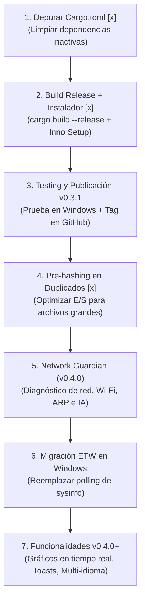

# SysPulse — Plan de Acción Único y Consolidado

**Documento Único de Referencia y Hoja de Ruta**  
**Fecha de actualización:** 13 de noviembre de 2026  
**Versión actual:** v0.3.1 (en preparación de release)  
**Idioma principal:** Español (Argentina / Neutro) — *Soporte multi-idioma (Inglés) pospuesto para actualización futura.*  
**Repositorio oficial:** [https://github.com/H3rC4/syspulse](https://github.com/H3rC4/syspulse)  

---

## 1. Resumen de la Aplicación y Arquitectura

**SysPulse** es un optimizador y monitor de sistema multiplataforma (enfocado principalmente en Windows 10/11), ligero, 100% offline y de código abierto. Posee una interfaz gráfica nativa acelerada por GPU desarrollada en **Slint** con estética neón oscura, y un backend de bajo nivel en **Rust**.

### Módulos del Sistema:
1. **System Monitor:** Monitoreo en tiempo real (CPU global y por núcleo, memoria RAM, SWAP, discos con espacio libre/total, tráfico de red de subida/bajada, temperaturas de sensores y uptime). Opera de forma asíncrona sin bloquear la interfaz.
2. **Smart Cleaner:**
   - *Limpieza de temporales:* Elimina temporales de Windows y cachés de desarrollo (`npm`, `pip`, `cargo`), permitiendo enviar a Papelera o eliminación directa permanente (sin picos de RAM ni saturación de disco).
   - *Buscador de duplicados:* Agrupa archivos por tamaño idéntico y verifica mediante SHA-256, con opciones automáticas de selección (*Conservar más antiguo* / *más nuevo*).
   - *Cuarentena:* Carpeta segura con manifiesto JSON para restaurar o purgar duplicados apartados.
3. **CPU Focus:** Eleva la prioridad del proceso seleccionado a `ABOVE_NORMAL_PRIORITY_CLASS` en Windows (o `nice -5` en POSIX) para maximizar la fluidez de tareas críticas.
4. **Process Hunter:** Registro continuo de eventos de procesos en base de datos SQLite local (`syspulse.db`), detectando procesos transitorios (< 5s de vida) y permitiendo exportar auditorías forenses a JSON y CSV.
5. **System Tray & Ajustes:** Icono en bandeja de sistema (minimizar a bandeja, menú contextual, doble clic para restaurar), configuración persistente en `settings.toml` e inicio automático con Windows vía Registro (`HKCU\Software\Microsoft\Windows\CurrentVersion\Run`).
6. **Network Guardian (Nuevo Módulo en Planificación para v0.4.0):** Monitoreo, diagnóstico y seguridad de redes locales. Descubrimiento no invasivo de dispositivos (ARP / SendARP), identificación de fabricantes OUI, clasificación de confianza, diagnóstico de señal y congestión de canales Wi-Fi, monitorización de latencia/jitter/pérdida (ICMP Win32 nativo), correlación de sockets con PIDs de Process Hunter y exportación forense en JSON/CSV para IA. Ver detalle en [PLAN_NETWORK_GUARDIAN.md](PLAN_NETWORK_GUARDIAN.md).
7. **Pulse Intelligence Engine - PIE (Motor Transversal de Inteligencia para v0.4.0):** Núcleo de correlación heurística basado en eventos. Conecta Process Hunter, System Monitor y Network Guardian a través de un Event Bus Tokio en memoria. Identifica procesos de forma unívoca mediante tuplas `(PID, CreateTime)`, aplica ventanas temporales deslizantes y genera un sistema unificado de incidentes y evidencias observables (`pie_incidents`, `pie_incident_evidences`), evitando duplicar tablas de alertas o tareas de sondeo.

---

## 2. Estado de lo Implementado y Verificado (Completado)

Todo lo listado a continuación ha sido corregido, integrado y verificado con `cargo check` (0 errores):

- [x] **Slint UI Premium:** Paleta neón (fondos `#050508`, acentos cyan, purple, green), componentes personalizados, animaciones de 200–250 ms y layout responsive.
- [x] **Monitoreo Asíncrono Fluido:** Desacoplamiento de `SysMonitor::refresh()` del hilo de Slint a un worker en segundo plano de Tokio. Interfaz estable a 60+ FPS sin micro-congelamientos.
- [x] **Process Hunter Conectado a la UI:** La pestaña visual ya recibe los eventos en tiempo real, incluye botón de refresco y auto-carga al cambiar de pestaña.
- [x] **Cálculo de Tiempo de Vida en Procesos Transitorios:** Detección de procesos que finalizan en menos de 5 segundos y guardado automático de su `lifetime_seconds` en SQLite.
- [x] **Frecuencia de Mantenimiento de SQLite Optimizada:** La purga de historial (`trim_history`) se ejecuta una vez por hora en lugar de cada 500 ms, eliminando el desgaste del SSD.
- [x] **CPU Focus Corregido:** Visualización de memoria en megabytes reales (dividido por `1024 * 1024`) y reactividad inmediata del botón Focus/Unfocus.
- [x] **Cuarentena Reactiva:** La lista en pantalla se actualiza automáticamente al restaurar o eliminar un archivo.
- [x] **Seguridad de Handles Win32:** Cierre garantizado de claves de Registro (`RegCloseKey`) y handles de procesos (`CloseHandle`).
- [x] **Script de Instalador Corregido:** `installer.iss` reparado para compatibilidad con Inno Setup (llamadas HTTP mediante OLE `WinHttp.WinHttpRequest.5.1` y corrección sintáctica de funciones).
- [x] **Rutas Robustas para el Icono de Bandeja:** Detección automática de `icon.ico` tanto en entorno de desarrollo como en la carpeta de instalación.

---

## 3. Plan de Acción Único: Tareas Pendientes (Priorizadas)

Este es el único roadmap activo a seguir para las próximas sesiones de trabajo:



---

### 🔴 Prioridad 1: Optimización de Dependencias en `Cargo.toml` (Inmediato)
*Propósito: Acelerar drásticamente los tiempos de compilación y evitar código muerto en el binario final.*

- [x] **Eliminar dependencias inactivas:**
  - Remover `md5 = "0.7"` (nunca utilizada).
  - Remover `wmi = "0.14"` (nunca utilizada).
- [x] **Ajustar features de la biblioteca `windows`:**
  Reducido a las indispensables (`Win32_Foundation`, `Win32_System_Registry`, `Win32_System_Threading`, `Win32_Security`).
- [x] **Decisión i18n:** Advertencias asociadas al módulo `i18n.rs` y items sin uso resueltas (0 warnings con `cargo check`).

---

### 🔴 Prioridad 2: Compilación de Producción y Generación del Instalador (Inmediato)
*Propósito: Crear el ejecutable final optimizado y el instalador instalable para Windows.*

- [x] **Compilar en modo release:**
  `cargo build --release` completado exitosamente (`target/release/syspulse.exe` optimizado con `opt-level = "z"`, `strip = true`, `lto = true`).
- [x] **Actualizar versión a 0.3.1 en `installer.iss`:**
  Fijado `#define MyAppVersion "0.3.1"` y arquitectura corregida a `x64compatible`.
- [x] **Compilar instalador con Inno Setup:**
  Generado con éxito en `output/SysPulse-Setup-0.3.1.exe` (~7.2 MB).

---

### 🟡 Prioridad 3: Verificación de Usuario y Release Oficial en GitHub
*Propósito: Validación de la experiencia final y distribución pública.*

- [ ] **Prueba de instalación limpia:**
  - Ejecutar `output/SysPulse-Setup-0.3.1.exe`.
  - Probar instalación en directorio estándar.
  - Verificar que el icono de acceso directo y de bandeja cargan correctamente.
  - Probar ejecución minimizada con `--background`.
- [ ] **Publicar versión v0.3.1 en GitHub:**
  ```powershell
  git add .
  git commit -m "release: SysPulse v0.3.1 con fixes funcionales y optimizaciones"
  git tag v0.3.1
  git push origin main
  git push origin v0.3.1
  ```
  - Crear Release en [GitHub Releases](https://github.com/H3rC4/syspulse/releases/new) y adjuntar `SysPulse-Setup-0.3.1.exe`.

---

### 🟡 Prioridad 4: Pre-hashing en Duplicados (`cleaner.rs`)
*Propósito: Evitar calcular hashes SHA-256 completos en archivos de varios gigabytes cuando no son duplicados.*

- [x] **Implementar doble etapa de hashing:**
  - Lectura de los primeros 16 KB (`compute_file_pre_hash`) para filtrado previo rápido en archivos > 16 KB.
  - SHA-256 completo (`compute_file_hash`) únicamente ejecutado en archivos cuyo pre-hash coincide.
  - Búfer de lectura incrementado de 8 KB a 64 KB (`BUFFER_SIZE = 65536`) para maximizar rendimiento de I/O.

---

### 🔵 Prioridad 5: Módulo Network Guardian & Pulse Intelligence Engine (PIE) (v0.4.0)
*Propósito: Convertir a SysPulse en una suite avanzada de diagnóstico, monitoreo y seguridad de redes locales correlacionada con eventos de sistema y procesos.*
*Documento de Diseño Completo:* [PLAN_NETWORK_GUARDIAN.md](PLAN_NETWORK_GUARDIAN.md)  
*Estado:* **Arquitectura Técnica e Integración PIE Completadas** (Aguardando aprobación para inicio de implementación).

- [x] **Fase 0: Event Bus y Núcleo Base de PIE (Infraestructura Transversal Previa)**
  - Canal bounded Tokio centralizado con backpressure y timeout para eventos críticos (`mpsc(1024)`) y canal `broadcast(256)` para telemetría descartable.
  - Contabilización atómica de eventos perdidos (`dropped_critical`) sin descartes silenciosos.
  - Identidad unívoca de procesos `ProcessIdentity { pid, start_time_utc }` en UTC vía `GetProcessTimes` (Win32) para neutralizar colisiones por reciclaje de PID.
  - Tiempo monotónico (`Instant`) para ventanas temporales configurables por regla.
  - Esquema unificado de incidentes (`pie_incidents`, `pie_incident_evidences`) preparado para Modo Simple y Modo Avanzado en `syspulse.db`.
- [x] **Fase 1: Motor Base de Conectividad y Latencia**
  - Features de `windows-rs`: `Win32_NetworkManagement_IpHelper`, `Win32_Networking_WinSock`.
  - Sondeo ICMP nativo con `IcmpSendEcho` en espacio de usuario (sin elevación UAC).
  - Métricas RTT, Jitter (RFC 3550) y Packet Loss; detección de Gateway con `GetAdaptersAddresses`.
  - Emisión de métricas y cambios de estado al Event Bus de PIE.
  - *Estado de pruebas:* Verificado con 4 pruebas unitarias automáticas. Validación manual con hardware real registrada como pendiente para la fase final con UI.
- [x] **Fase 2: Diagnóstico Wi-Fi y Congestión de Canales**
  - Feature `Win32_NetworkManagement_WiFi`.
  - Conexión activa (SSID, BSSID, canal, frecuencia, RSSI, cifrado WPA2/WPA3, velocidad Tx/Rx).
  - Escaneo de redes circundantes con `WlanGetNetworkBssList` y cálculo de congestión de canales con recomendación óptima y disclaimer de RF físico.
  - Gestión tolerante a fallos para Ethernet exclusivo, Wi-Fi apagado y permisos de ubicación en Windows 10/11.
  - *Estado de pruebas:* Verificado con 4 pruebas unitarias automáticas. Validación manual con hardware real registrada como pendiente para la fase final con UI.
- [x] **Fase 3: Descubrimiento de Dispositivos en Red Local (ARP & OUI) [Completado y Verificado]**
  - Lectura de tabla ARP pasiva del kernel (`GetIpNetTable2`).
  - Escáner activo no invasivo mediante `SendARP` rate-limited sobre la subred local (sin Npcap), con IP de origen local y protección de VPNs.
  - Resolución de hostnames (mDNS / NetBIOS / PTR) con caché, timeout y trabajadores limitados (`JoinSet` + `Semaphore`).
  - Base OUI oficial IEEE estática con clasificación correcta de MAC administradas localmente (LAA).
  - Inventario inicial silencioso (baseline) por red e identidades aisladas (`NetworkContext`).
  - Emisión de evento `NewDeviceDiscovered` al Event Bus de PIE.
  - Rectificación de afirmaciones no verificadas sobre IDS y preservación de i18n (EN / ES-AR).
  - *Estado de pruebas:* Verificado con 18 pruebas unitarias automáticas de red (22 tests totales del proyecto pasando). Validación manual con hardware real registrada como pendiente para la fase final con UI.

---

### 📋 Pruebas Manuales y de Usabilidad Pendientes (A realizar al finalizar todas las fases con la UI de Slint operativa)

1. **Conectividad y Latencia (Fase 1):**
   - Comparar RTT y Jitter frente al comando `ping` nativo en Windows 10 y 11.
   - Comprobar comportamiento al desconectar el cable de red o cambiar de Gateway (hot-plug de interfaz).
2. **Wi-Fi Analyzer (Fase 2):**
   - Cotejar intensidad de señal (%) y SSID con el panel de red nativo de la bandeja de Windows (+/- 5%).
   - Verificar detección de canales en routers de doble banda (2.4 GHz y 5 GHz) y Wi-Fi 6 (802.11ax).
   - Validar comportamiento al activar el Modo Avión en Windows.
3. **Descubrimiento de Dispositivos (Fase 3):**
   - Escanear una red local doméstica real y verificar que detecte el router, smartphones, Smart TVs y laptops.
   - Validar que los fabricantes OUI correspondan a marcas reales (Apple, Samsung, Intel, TP-Link, etc.).
   - Verificar que el escaneo activo no sature el router ni dispare alertas de intrusión.
4. **Experiencia de Usuario (UI Simple vs. Avanzada):**
   - Validar con usuarios no técnicos que los textos explicativos y recomendaciones sean inmediatamente comprensibles.
- [ ] **Fase 4: Motor de Correlación Heurística de Incidentes y Persistencia Unificada**
  - [x] **Subtarea 4.1: Creación de tablas y modelos en `syspulse.db` (Alternativa D Aprobada):**
    - Clave primaria compuesta `(network_id, mac)` en `net_devices` con aislamiento de baselines, alias y confianza por red.
    - `net_metrics_history` particionada por `network_id` e `interface_name`, con métricas `Option<f32>` (distinción estricta de ausente `NULL` vs cero).
    - Migraciones SQLite versionadas (`PRAGMA user_version = 2`), transaccionales y no destructivas conservando datos históricos bajo `legacy_unassigned` sin transferir confianza.
    - Retención configurable vía `net_metrics_retention_days` en `Settings` (7 días por defecto).
  - [x] **Subtarea 4.2: Conexión de persistencia y deduplicación entre reinicios:**
    - Handlers en `PulseIntelligenceEngine::process_critical_event` para persistir automáticamente dispositivos descubiertos (`NewDeviceDiscovered`) actualizando `ip` y `last_seen` preservando alias y confianza.
    - Handlers en `PulseIntelligenceEngine::process_telemetry_event` para almacenar muestras periódicas de conectividad en `net_metrics_history` con purga horaria automática por retención.
    - Captura del contexto de red en el momento de la observación y propagación a los eventos de telemetría y eventos críticos.
    - Persistencia y deduplicación verificadas mediante 13 pruebas unitarias exhaustivas en PIE (31 pruebas totales en la suite).
  - [x] **Subtarea 4.3: Motor de Correlación Heurística en PIE (100% de las 11 Decisiones Aprobadas Implementadas):**
    - Motor de correlación asíncrono en `PulseIntelligenceEngine` respaldado 100% por productores y telemetría reales:
      1. `PIE-R-WIFI-DEG`: Degradación severa de enlace Wi-Fi (< 25% sostenido) correlacionada centralmente en PIE con latencia local, jitter (> 20 ms) y pérdida de paquetes (> 5%), e histéresis de recuperación (>= 45%).
      2. `PIE-R-NET-EXT-DOWN`: Falla de conectividad WAN con Gateway local operativo (< 40 ms RTT) propagando `InternetHealth` para diferenciar filtrado ICMP de desconexión real.
      3. `PIE-R005`: Detección de Gateway fraudulento o cambio anómalo de DNS con dispositivo no confiable, registrando contexto anterior y posterior (IP de gateway, red e interfaz).
      4. `PIE-R-NET-IP-CONFLICT`: Detección de colisión/suplantación de IP activa diferenciando reasignaciones normales de DHCP (> 10 min de inactividad de la MAC previa).
      5. `PIE-R-PROC-HIGH-CPU`: Consumo elevado y sostenido de CPU por proceso normalizado por núcleos lógicos, confirmación sostenida de 15–30 segundos configurables e histéresis (< 50%).
      6. `PIE-R-MEM-PRESSURE`: Presión sostenida de memoria física (> 85% en 3 ticks) con seguimiento acotado del crecimiento de memoria de procesos mediante `ProcessIdentity` sin afirmar falsas fugas, y resolución por histéresis (< 75%).
      7. `PIE-R-SYS-SATURATION`: Saturación global de hardware y estrés térmico diferenciado por componente (NVMe > 70°C, GPU > 88°C, CPU > 90°C) sin asumir estrangulamiento térmico (throttling) sin evidencia de reloj.
      8. `Context Validation`: Validación estricta del contexto de red antes y después de cada escaneo o medición, descartando resultados ambiguos sin reasignaciones arbitrarias.
      9. `PIE Robustness`: Gestión de pérdida de eventos en el Event Bus, salto monotónico por suspensión/hibernación (> 60s), búfer circular acotado a 500 y expiración a 120s.
      10. `DNS Resolver Semaphore`: Permisos del semáforo retenidos dentro de la tarea bloqueante nativa hasta su culminación real, incluso tras timeout de 600 ms.
      11. `OUI & LAA Classification`: Detección estricta de MAC LAA y registro del requisito obligatorio previo a publicación final sobre la base OUI de la IEEE.
    - Deduplicación de incidentes y evidencias entre reinicios (`correlation_key` y caché activa), debouncing de evidencias (10s), resolución automática de incidentes por normalización de condiciones y preparación para Modo Simple y Avanzado (Fluent EN / ES-AR).
    - Suite completa con 24 pruebas unitarias en PIE (45 pruebas totales en el workspace).
  - [ ] **Subtarea 4.4: Exportador Forense Unificado para IA:**
    - Exportador unificado de incidentes y evidencias a JSON estructurado y CSV para IA.
- [ ] **Fase 5: UI Slint Neón y Correlación con Process Hunter**
  - Pestaña Network Guardian y Centro de Incidentes de PIE en `ui/app.slint`.
  - Correlación de sockets abiertos con PIDs de procesos mediante `GetExtendedTcpTable`.

---

### 🟢 Prioridad 6: Migración de Process Hunter a ETW en Windows
*Propósito: Reducir a 0% el uso de CPU en reposo de la auditoría de procesos.*

- [ ] Sustituir el bucle de polling de `sysinfo` (cada 500 ms) en Windows por un consumidor de eventos del kernel vía **Event Tracing for Windows (ETW)** para recibir notificaciones instantáneas de creación y finalización de procesos por hardware/kernel.

---

### 🟢 Prioridad 7: Funcionalidades Futuras (v0.4.0+)
- [ ] **Gráficos en tiempo real:** Mini-gráficos tipo sparkline de los últimos 60 segundos para CPU, RAM y Red en la pestaña Monitor.
- [ ] **Notificaciones Toast nativas:** Avisos del sistema al completar limpiezas o ante alertas térmicas (> 85°C).
- [ ] **Modo Portable:** Si existe un archivo `portable.txt` junto al ejecutable, almacenar configuración y bases de datos en la misma carpeta local.
- [ ] **Soporte de Inglés dinámico:** Implementar selección y cambio dinámico de idioma en la interfaz.
- [ ] **CI/CD con GitHub Actions:** Archivo `.github/workflows/build.yml` para compilar automáticamente en cada push y generar releases en tags.

---

## 4. Guía de Comandos Rápidos para Iniciar Sesión

```powershell
# 1. Posicionarse en la carpeta del proyecto
cd D:\proyectos\SysPulse

# 2. Verificar estado de compilación
cargo check

# 3. Compilar en modo debug para desarrollo
cargo build
.\target\debug\syspulse.exe

# 4. Compilar versión release optimizada
cargo build --release
.\target\release\syspulse.exe

# 5. Ejecutar con logs de depuración
$env:RUST_LOG="debug"; .\target\release\syspulse.exe

# 6. Compilar el instalador oficial
& "C:\Program Files\Inno Setup 7\ISCC.exe" installer.iss
```
