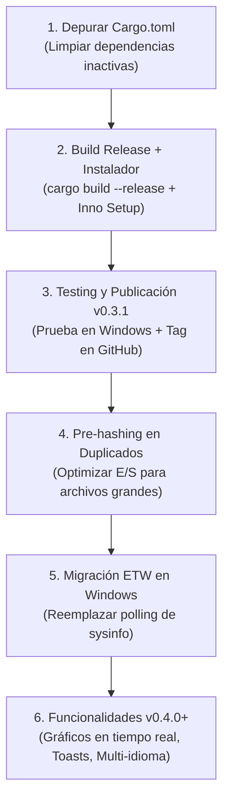

# SysPulse — Plan de Acción Único y Consolidado

**Documento Único de Referencia y Hoja de Ruta**  
**Fecha de actualización:** 13 de noviembre de 2026  
**Versión actual:** v0.3.1 (en preparación de release)  
**Idioma principal:** Español (Argentina / Neutro) — *Soporte multi-idioma (Inglés) pospuesto para actualización futura.*  
**Repositorio oficial:** [https://github.com/H3rC4/syspulse](https://github.com/H3rC4/syspulse)  

---

## 1. Resumen de la Aplicación y Arquitectura

**SysPulse** es un optimizador y monitor de sistema multiplataforma (enfocado principalmente en Windows 10/11), ligero, 100% offline y de código abierto. Posee una interfaz gráfica nativa acelerada por GPU desarrollada en **Slint** con estética neón oscura, y un backend de bajo nivel en **Rust**.

### Módulos del Sistema:
1. **System Monitor:** Monitoreo en tiempo real (CPU global y por núcleo, memoria RAM, SWAP, discos con espacio libre/total, tráfico de red de subida/bajada, temperaturas de sensores y uptime). Opera de forma asíncrona sin bloquear la interfaz.
2. **Smart Cleaner:**
   - *Limpieza de temporales:* Elimina temporales de Windows y cachés de desarrollo (`npm`, `pip`, `cargo`), permitiendo enviar a Papelera o eliminación directa permanente (sin picos de RAM ni saturación de disco).
   - *Buscador de duplicados:* Agrupa archivos por tamaño idéntico y verifica mediante SHA-256, con opciones automáticas de selección (*Conservar más antiguo* / *más nuevo*).
   - *Cuarentena:* Carpeta segura con manifiesto JSON para restaurar o purgar duplicados apartados.
3. **CPU Focus:** Eleva la prioridad del proceso seleccionado a `ABOVE_NORMAL_PRIORITY_CLASS` en Windows (o `nice -5` en POSIX) para maximizar la fluidez de tareas críticas.
4. **Process Hunter:** Registro continuo de eventos de procesos en base de datos SQLite local (`syspulse.db`), detectando procesos transitorios (< 5s de vida) y permitiendo exportar auditorías forenses a JSON y CSV.
5. **System Tray & Ajustes:** Icono en bandeja de sistema (minimizar a bandeja, menú contextual, doble clic para restaurar), configuración persistente en `settings.toml` e inicio automático con Windows vía Registro (`HKCU\Software\Microsoft\Windows\CurrentVersion\Run`).

---

## 2. Estado de lo Implementado y Verificado (Completado)

Todo lo listado a continuación ha sido corregido, integrado y verificado con `cargo check` (0 errores):

- [x] **Slint UI Premium:** Paleta neón (fondos `#050508`, acentos cyan, purple, green), componentes personalizados, animaciones de 200–250 ms y layout responsive.
- [x] **Monitoreo Asíncrono Fluido:** Desacoplamiento de `SysMonitor::refresh()` del hilo de Slint a un worker en segundo plano de Tokio. Interfaz estable a 60+ FPS sin micro-congelamientos.
- [x] **Process Hunter Conectado a la UI:** La pestaña visual ya recibe los eventos en tiempo real, incluye botón de refresco y auto-carga al cambiar de pestaña.
- [x] **Cálculo de Tiempo de Vida en Procesos Transitorios:** Detección de procesos que finalizan en menos de 5 segundos y guardado automático de su `lifetime_seconds` en SQLite.
- [x] **Frecuencia de Mantenimiento de SQLite Optimizada:** La purga de historial (`trim_history`) se ejecuta una vez por hora en lugar de cada 500 ms, eliminando el desgaste del SSD.
- [x] **CPU Focus Corregido:** Visualización de memoria en megabytes reales (dividido por `1024 * 1024`) y reactividad inmediata del botón Focus/Unfocus.
- [x] **Cuarentena Reactiva:** La lista en pantalla se actualiza automáticamente al restaurar o eliminar un archivo.
- [x] **Seguridad de Handles Win32:** Cierre garantizado de claves de Registro (`RegCloseKey`) y handles de procesos (`CloseHandle`).
- [x] **Script de Instalador Corregido:** `installer.iss` reparado para compatibilidad con Inno Setup (llamadas HTTP mediante OLE `WinHttp.WinHttpRequest.5.1` y corrección sintáctica de funciones).
- [x] **Rutas Robustas para el Icono de Bandeja:** Detección automática de `icon.ico` tanto en entorno de desarrollo como en la carpeta de instalación.

---

## 3. Plan de Acción Único: Tareas Pendientes (Priorizadas)

Este es el único roadmap activo a seguir para las próximas sesiones de trabajo:



---

### 🔴 Prioridad 1: Optimización de Dependencias en `Cargo.toml` (Inmediato)
*Propósito: Acelerar drásticamente los tiempos de compilación y evitar código muerto en el binario final.*

- [x] **Eliminar dependencias inactivas:**
  - Remover `md5 = "0.7"` (nunca utilizada).
  - Remover `wmi = "0.14"` (nunca utilizada).
- [x] **Ajustar features de la biblioteca `windows`:**
  Reducido a las indispensables (`Win32_Foundation`, `Win32_System_Registry`, `Win32_System_Threading`, `Win32_Security`).
- [x] **Decisión i18n:** Advertencias asociadas al módulo `i18n.rs` y items sin uso resueltas (0 warnings con `cargo check`).

---

### 🔴 Prioridad 2: Compilación de Producción y Generación del Instalador (Inmediato)
*Propósito: Crear el ejecutable final optimizado y el instalador instalable para Windows.*

- [x] **Compilar en modo release:**
  `cargo build --release` completado exitosamente (`target/release/syspulse.exe` optimizado con `opt-level = "z"`, `strip = true`, `lto = true`).
- [x] **Actualizar versión a 0.3.1 en `installer.iss`:**
  Fijado `#define MyAppVersion "0.3.1"` y arquitectura corregida a `x64compatible`.
- [x] **Compilar instalador con Inno Setup:**
  Generado con éxito en `output/SysPulse-Setup-0.3.1.exe` (~7.2 MB).

---

### 🟡 Prioridad 3: Verificación de Usuario y Release Oficial en GitHub
*Propósito: Validación de la experiencia final y distribución pública.*

- [ ] **Prueba de instalación limpia:**
  - Ejecutar `output/SysPulse-Setup-0.3.1.exe`.
  - Probar instalación en directorio estándar.
  - Verificar que el icono de acceso directo y de bandeja cargan correctamente.
  - Probar ejecución minimizada con `--background`.
- [ ] **Publicar versión v0.3.1 en GitHub:**
  ```powershell
  git add .
  git commit -m "release: SysPulse v0.3.1 con fixes funcionales y optimizaciones"
  git tag v0.3.1
  git push origin main
  git push origin v0.3.1
  ```
  - Crear Release en [GitHub Releases](https://github.com/H3rC4/syspulse/releases/new) y adjuntar `SysPulse-Setup-0.3.1.exe`.

---

### 🟡 Prioridad 4: Pre-hashing en Duplicados (`cleaner.rs`)
*Propósito: Evitar calcular hashes SHA-256 completos en archivos de varios gigabytes cuando no son duplicados.*

- [x] **Implementar doble etapa de hashing:**
  - Lectura de los primeros 16 KB (`compute_file_pre_hash`) para filtrado previo rápido en archivos > 16 KB.
  - SHA-256 completo (`compute_file_hash`) únicamente ejecutado en archivos cuyo pre-hash coincide.
  - Búfer de lectura incrementado de 8 KB a 64 KB (`BUFFER_SIZE = 65536`) para maximizar rendimiento de I/O.

---

### 🟢 Prioridad 5: Migración de Process Hunter a ETW en Windows
*Propósito: Reducir a 0% el uso de CPU en reposo de la auditoría de procesos.*

- [ ] Sustituir el bucle de polling de `sysinfo` (cada 500 ms) en Windows por un consumidor de eventos del kernel vía **Event Tracing for Windows (ETW)** para recibir notificaciones instantáneas de creación y finalización de procesos por hardware/kernel.

---

### 🟢 Prioridad 6: Funcionalidades Futuras (v0.4.0+)
- [ ] **Gráficos en tiempo real:** Mini-gráficos tipo sparkline de los últimos 60 segundos para CPU, RAM y Red en la pestaña Monitor.
- [ ] **Notificaciones Toast nativas:** Avisos del sistema al completar limpiezas o ante alertas térmicas (> 85°C).
- [ ] **Modo Portable:** Si existe un archivo `portable.txt` junto al ejecutable, almacenar configuración y bases de datos en la misma carpeta local.
- [ ] **Soporte de Inglés dinámico:** Implementar selección y cambio dinámico de idioma en la interfaz.
- [ ] **CI/CD con GitHub Actions:** Archivo `.github/workflows/build.yml` para compilar automáticamente en cada push y generar releases en tags.

---

## 4. Guía de Comandos Rápidos para Iniciar Sesión

```powershell
# 1. Posicionarse en la carpeta del proyecto
cd D:\proyectos\SysPulse

# 2. Verificar estado de compilación
cargo check

# 3. Compilar en modo debug para desarrollo
cargo build
.\target\debug\syspulse.exe

# 4. Compilar versión release optimizada
cargo build --release
.\target\release\syspulse.exe

# 5. Ejecutar con logs de depuración
$env:RUST_LOG="debug"; .\target\release\syspulse.exe

# 6. Compilar el instalador oficial
& "C:\Program Files\Inno Setup 7\ISCC.exe" installer.iss
```
