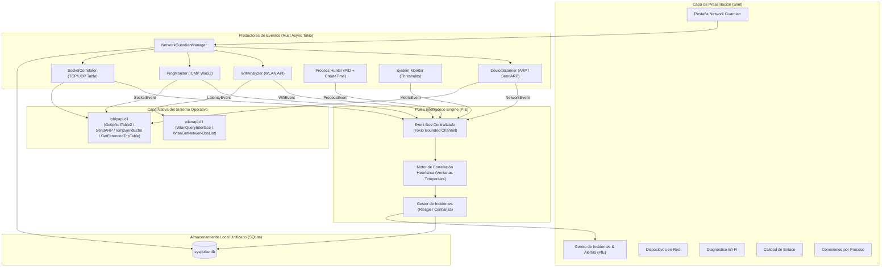
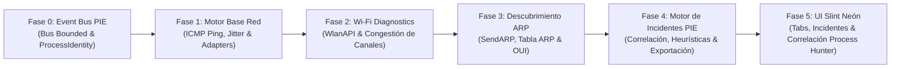

# SysPulse — Documento de Diseño y Arquitectura: Network Guardian

**Módulo:** Network Guardian (Monitoreo, Diagnóstico y Seguridad de Red)  
**Fecha:** 22 de noviembre de 2026  
**Estado:** Fases 0 a 5 Implementadas; Observaciones de Campo en GUI Windows Verificadas (22 de noviembre de 2026)  
**Versión objetivo:** SysPulse v0.4.0  

---

## 1. Resumen Ejecutivo y Objetivos

**Network Guardian** es un nuevo módulo avanzado para **SysPulse** diseñado para transformar la aplicación en una suite integral de diagnóstico, monitoreo y seguridad de redes locales y conexiones inalámbricas, sin requerir controladores de terceros (como WinPcap o Npcap) ni privilegios de administrador.

El módulo mantiene la filosofía central de SysPulse:
- **100% Offline y Seguro:** Sin telemetría externa, sin almacenamiento de contraseñas de red y sin captura del contenido privado del tráfico.
- **Rendimiento Nativo en Rust:** Operaciones asíncronas no bloqueantes con **Tokio** y bajo consumo de CPU (< 0.5% en reposo) y memoria (< 15 MB adicionales).
- **Interfaz Acelerada por GPU:** Desarrollada en **Slint** con la estética neón oscura característica del proyecto.
- **Integración con Process Hunter:** Correlación bidireccional entre conexiones de red y los procesos del sistema responsables de abrirlas.

---

## 2. Requisitos Funcionales

1. **Descubrimiento de Dispositivos en Red Local:**
   - Detección pasiva inmediata consultando la tabla ARP del kernel del sistema operativo.
   - Descubrimiento activo **no invasivo** mediante solicitudes unicast ARP controladas (`SendARP`) en la subred local actual (evita alertas de intrusión en routers y no satura el ancho de banda).
2. **Identificación Completa de Dispositivos:**
   - Dirección IP local (IPv4 / IPv6).
   - Dirección física MAC.
   - Hostname mediante resolución DNS inversa local (mDNS / NetBIOS / PTR).
   - Fabricante del adaptador de red mediante base de datos de prefijos OUI (Organizationally Unique Identifier) de la IEEE (empaquetada localmente y offline).
3. **Gestión de Confianza y Alertas:**
   - Clasificación de dispositivos en **Confiables** (*Trusted*) o **Desconocidos** (*Unknown*).
   - Posibilidad de asignar alias personalizados a dispositivos conocidos (ej. *"Mi Laptop"*, *"Impresora Oficina"*).
   - Disparo de alertas visuales en la interfaz y en la bandeja del sistema cuando se detecte un dispositivo nuevo en la red.
4. **Diagnóstico Wi-Fi y Análisis de Congestión:**
   - Métricas de la conexión Wi-Fi activa: SSID, BSSID, protocolo (802.11ax/ac/n/g), canal, frecuencia (2.4 GHz, 5 GHz, 6 GHz), intensidad de señal (RSSI en dBm y porcentaje), tipo de cifrado/seguridad (WPA2, WPA3) y tasa de enlace (Mbps Tx/Rx).
   - **Análisis de congestión de canales:** Escaneo de puntos de acceso vecinos para graficar la ocupación de canales circundantes y recomendar canales óptimos con menor interferencia.
5. **Monitoreo de Calidad de Enlace (Latencia, Jitter y Pérdida):**
   - Sondeos ICMP periódicos al Gateway local y a un resolutor público configurable (ej. `1.1.1.1` o `8.8.8.8`).
   - Cálculo de RTT (Round Trip Time) promedio, mínimo y máximo.
   - Cálculo de **Jitter** en tiempo real conforme al estándar RFC 3550.
   - Detección de pérdida de paquetes (*packet loss percentage*) en una ventana móvil de muestras.
6. **Integración con Process Hunter:**
   - Identificación de conexiones TCP/UDP activas por proceso (`dwOwningPid`), permitiendo conocer qué procesos locales se comunican con los dispositivos de la red o hacia internet.
7. **Historial Persistente y Exportación Forense para IA:**
   - Almacenamiento local en SQLite (`syspulse.db`).
   - Exportación de auditorías de red a **JSON** estructurado y **CSV** con métricas listas para análisis por modelos de inteligencia artificial o administradores de sistemas.

---

## 3. Arquitectura del Sistema



### Abstracción Multiplataforma

Para garantizar que el módulo pueda expandirse a Linux y macOS en el futuro, se define una capa de rasgos (*traits*):

```rust
#[async_trait::async_trait]
pub trait NetworkDiscoveryProvider: Send + Sync {
    async fn scan_local_devices(&self, subnet: &Subnet) -> Result<Vec<DiscoveredDevice>>;
    async fn resolve_hostname(&self, ip: IpAddr) -> Option<String>;
}

#[async_trait::async_trait]
pub trait WifiDiagnosticsProvider: Send + Sync {
    async fn current_connection_info(&self) -> Result<Option<WifiConnectionInfo>>;
    async fn scan_channel_congestion(&self) -> Result<Vec<ChannelCongestionInfo>>;
}

#[async_trait::async_trait]
pub trait LatencyMonitorProvider: Send + Sync {
    async fn ping(&self, target: IpAddr) -> Result<PingSample>;
}
```

- **Windows:** Implementado directamente con `windows-rs` sobre `iphlpapi.dll` y `wlanapi.dll`.
- **Linux (futuro):** Implementado leyendo `/proc/net/arp`, Netlink / `iw` vía D-Bus y sockets ICMP nativos.
- **macOS (futuro):** Implementado con llamadas al framework `CoreWLAN` y comandos ARP del sistema.

---

## 4. Análisis de Dependencias y APIs de Windows (`windows-rs`)

### 4.1. Características de `windows-rs` requeridas en `Cargo.toml`

Para implementar Network Guardian sin bibliotecas externas pesadas, se habilitarán únicamente las features indispensables de `windows`:

```toml
[target.'cfg(windows)'.dependencies]
windows = { version = "0.54", features = [
    # Existentes en SysPulse v0.3.1:
    "Win32_Foundation",
    "Win32_System_Registry",
    "Win32_System_Threading",
    "Win32_Security",
    # Nuevas requeridas para Network Guardian:
    "Win32_NetworkManagement_IpHelper",  # GetIpNetTable2, SendARP, GetAdaptersAddresses, IcmpSendEcho, GetExtendedTcpTable
    "Win32_NetworkManagement_WiFi",      # WlanOpenHandle, WlanEnumInterfaces, WlanQueryInterface, WlanGetNetworkBssList
    "Win32_Networking_WinSock",          # Estructuras de sockets (SOCKADDR_INET, AF_INET)
] }
```

### 4.2. Detalle de APIs Nativas Utilizadas

| Funcionalidad | API Win32 Nativa | Ventajas / Justificación |
|---|---|---|
| **Tabla ARP local** | `GetIpNetTable2` | Obtención instantánea en microsegundos de la caché ARP sin generar tráfico. |
| **Descubrimiento Activo** | `SendARP` | Envía una petición ARP unicast nativa por IP. **No requiere WinPcap/Npcap ni modo promiscuo**. Funciona en modo usuario sin permisos de administrador. |
| **Adaptadores y Subred** | `GetAdaptersAddresses` | Detecta subred local (ej. `192.168.1.0/24`), puerta de enlace (Gateway) y DNS primario de cada interfaz de red. |
| **Latencia / Ping** | `IcmpCreateFile`, `IcmpSendEcho`, `IcmpCloseHandle` | Implementación ICMP nativa en espacio de usuario. **No requiere raw sockets** (los cuales requieren privilegios de Administrador en Windows). |
| **Wi-Fi Conexión Actual** | `WlanOpenHandle`, `WlanQueryInterface` (`wlan_intf_opcode_current_connection`) | Provee SSID, BSSID, RSSI, algoritmo de cifrado, velocidad de enlace y señal. |
| **Congestión de Canales** | `WlanGetNetworkBssList` | Lista todas las redes visibles en el área con su frecuencia exacta en kHz y RSSI en dBm, permitiendo calcular la superposición de canales (1, 6, 11 en 2.4 GHz, y canales 36-165 en 5 GHz). |
| **Correlación de Procesos** | `GetExtendedTcpTable`, `GetExtendedUdpTable` (`TCP_TABLE_OWNER_PID_ALL`) | Vincula cada conexión de red (IP local, IP remota, puerto) con el PID del proceso de Windows que la originó. |

---

## 5. Diseño de Base de Datos SQLite e Integración de Alertas (Sin Duplicación)

Para evitar duplicar sistemas de alertas, timers o tablas inconexas, las alertas de red se integran directamente en el **Sistema Centralizado de Incidentes de Pulse Intelligence Engine (PIE)** en `%LOCALAPPDATA%\SysPulse\syspulse.db`:

```sql
-- ── 1. Dispositivos descubiertos en la red local (Alternativa D: Aislamiento por Red) ──
CREATE TABLE IF NOT EXISTS net_devices (
    network_id TEXT NOT NULL,
    mac TEXT NOT NULL,
    ip TEXT NOT NULL,
    hostname TEXT,
    vendor TEXT,
    is_trusted INTEGER NOT NULL DEFAULT 0,
    custom_alias TEXT,
    first_seen TEXT NOT NULL,
    last_seen TEXT NOT NULL,
    PRIMARY KEY (network_id, mac)
);

-- ── 2. Muestreo periódico de calidad de enlace (retención configurable en Settings, default 7 días) ──
CREATE TABLE IF NOT EXISTS net_metrics_history (
    id INTEGER PRIMARY KEY AUTOINCREMENT,
    network_id TEXT NOT NULL,
    interface_name TEXT,
    timestamp TEXT NOT NULL,
    gateway_rtt_ms REAL,
    internet_rtt_ms REAL,
    jitter_ms REAL,
    packet_loss_percent REAL
);

-- ── 3. Sistema Unificado de Incidentes y Evidencias (PIE) ──
-- Subsume 'net_alerts' y cualquier alerta de seguridad/rendimiento
CREATE TABLE IF NOT EXISTS pie_incidents (
    id INTEGER PRIMARY KEY AUTOINCREMENT,
    timestamp TEXT NOT NULL,
    category TEXT NOT NULL,        -- 'network', 'process', 'performance', 'security'
    severity TEXT NOT NULL,        -- 'info', 'low', 'medium', 'high', 'critical'
    risk_score INTEGER NOT NULL,   -- 0 a 100 (heurística observable)
    confidence REAL NOT NULL,      -- 0.0 a 1.0 (nivel de certidumbre)
    status TEXT NOT NULL DEFAULT 'active', -- 'active', 'acknowledged', 'resolved'
    title TEXT NOT NULL,
    simple_summary TEXT NOT NULL,
    simple_recommendation TEXT NOT NULL,
    technical_rule_id TEXT NOT NULL
);

CREATE TABLE IF NOT EXISTS pie_incident_evidences (
    id INTEGER PRIMARY KEY AUTOINCREMENT,
    incident_id INTEGER NOT NULL,
    timestamp TEXT NOT NULL,
    source_module TEXT NOT NULL,   -- 'network_guardian', 'process_hunter', 'sys_monitor'
    event_type TEXT NOT NULL,      -- 'untrusted_mac', 'transient_exec', 'gateway_mismatch', 'cpu_saturation'
    observable_json TEXT NOT NULL, -- JSON con hechos medidos (IP, MAC, PID, create_time, path, usage)
    FOREIGN KEY(incident_id) REFERENCES pie_incidents(id) ON DELETE CASCADE
);

-- Índices de consulta rápida
CREATE INDEX IF NOT EXISTS idx_net_devices_network_mac ON net_devices(network_id, mac);
CREATE INDEX IF NOT EXISTS idx_net_devices_network_last_seen ON net_devices(network_id, last_seen);
CREATE INDEX IF NOT EXISTS idx_net_devices_ip ON net_devices(ip);
CREATE INDEX IF NOT EXISTS idx_net_metrics_history_net_ts ON net_metrics_history(network_id, timestamp);
CREATE INDEX IF NOT EXISTS idx_net_metrics_history_ts ON net_metrics_history(timestamp);
CREATE INDEX IF NOT EXISTS idx_pie_incidents_timestamp ON pie_incidents(timestamp);
CREATE INDEX IF NOT EXISTS idx_pie_evidences_incident ON pie_incident_evidences(incident_id);
```

> **Estrategia anti-duplicación:**  
> Cuando Network Guardian detecta un nuevo dispositivo no confiable, se genera un registro en `pie_incidents` (categoría `network`) y se almacena la evidencia en `pie_incident_evidences`. Si posteriormente ese dispositivo se vincula con un proceso sospechoso detectado por Process Hunter, PIE adjunta una segunda evidencia al mismo incidente y recalcula la puntuación de riesgo y confianza, sin crear tablas de alertas redundantes ni duplicar datos.

---

## 6. Diseño de la Interfaz Gráfica (Slint UI)

Network Guardian se incorporará como una nueva pestaña principal en la barra lateral neón de SysPulse:

```
[Icono \u{25C9}] Network Guardian
```

La pestaña contará con 4 secciones internas seleccionables con *TabPills*:

1. **Dispositivos (`Devices`):**
   - Tabla estilizada con lista de dispositivos detectados: Estado (Online/Offline), IP, MAC, Hostname, Fabricante y badge neón (*Confiable / Desconocido*).
   - Botón de escaneo rápido de red (*"Escanear Red"*).
   - Botón contextual para marcar como confiable o editar el alias del dispositivo.
   - **Mejoras identificadas en pruebas de campo:**
     - **NG-01:** Optimizar descubrimiento activo sin depender únicamente de la caché ARP local existente en el kernel (caso de dispositivos como iPhones alcanzables que no emiten tráfico previo).
     - **NG-02:** Separar en la interfaz dispositivos conocidos de confirmados y no confirmados/offline; evitar clasificar como offline tras un solo sondeo fallido y mostrar marcas de tiempo `last_seen`.
     - **NG-03:** Soporte para alias personalizados persistentes e identificación unívoca para direcciones MAC administradas localmente (LAA) o privadas/rotativas.
2. **Wi-Fi & Canales (`Wi-Fi Analyzer`):**
   - Tarjeta con detalles de la conexión actual: SSID, Intensidad de Señal con barra de progreso Neón Cyan, Canal actual, Frecuencia y Cifrado.
   - **Gráfico de Congestión de Canales:** Visualización en barras verticales neón indicando la saturación de cada canal y recomendación del mejor canal disponible.
   - **Recomendación por banda:** Distinguir explícitamente las recomendaciones de canales entre las bandas de 2.4 GHz y 5 GHz.
3. **Calidad de Enlace (`Link Quality`):**
   - Indicadores numéricos de Latencia (Gateway e Internet), Jitter y Pérdida de paquetes.
   - Historial de latencia en sparkline de los últimos 60 segundos.
   - Formateo adecuado de Jitter sin decimales excesivos.
4. **Tráfico por Proceso (`Process Network`):**
   - Vista integrada con Process Hunter: listado de procesos locales con sockets abiertos, puertos locales y destinos remotos.
   - Corrección de badges de estado: diferenciar sockets en estado `LISTEN` (`Listening` / `Escuchando`) de conexiones activas establecidas.

---

## 7. Seguridad, Privacidad y Permisos

- **Sin privilegios elevados (UAC):** Todas las APIs seleccionadas (`SendARP`, `IcmpSendEcho`, `WlanQueryInterface`, `GetIpNetTable2`) funcionan bajo cuentas de usuario estándar de Windows sin requerir elevación de administrador.
- **Sin captura de paquetes privados (Sniffing):** No se inspecciona el tráfico de datos de otros dispositivos en la red ni se interceptan contraseñas o contenido HTTP/HTTPS.
- **Sin alteración de red:** SysPulse opera de modo estrictamente de diagnóstico y auditoría; no modifica configuraciones del router, DNS ni tablas de enrutamiento del sistema operativo.
- **Escaneo No Invasivo y Bajo Demanda (Rectificación IDS):** Las solicitudes ARP se emiten con cadencia controlada (máximo 25 paquetes por segundo) y concurrencia estrictamente serializada para mitigar la carga de red en routers domésticos. Se rectifica cualquier afirmación de invulnerabilidad frente a IDS: en entornos corporativos o switches administrados con Dynamic ARP Inspection (DAI) o sistemas IDS/IPS (como Snort o Suricata), cualquier barrido sistemático de IPs puede ser catalogado como anómalo. Por esta razón, el descubrimiento activo opera exclusivamente bajo demanda manual del usuario y el descubrimiento pasivo (tabla ARP local de la MIB del kernel) es el predeterminado.
- **Procedencia y Redistribución de Base OUI:** La base de datos de fabricantes proviene del registro público oficial de la IEEE (*IEEE Standards Association Public OUI Registry*, https://standards-oui.ieee.org/). Constituye información técnica de dominio público para interoperabilidad de protocolos de enlace IEEE 802, sin código con copyright de terceros ni datos personales.
  > [!IMPORTANT]
  > **Requisito Obligatorio Previo a Publicación Final:** Es requisito bloqueante obligatorio verificar y certificar las condiciones oficiales de redistribución de la base OUI de la IEEE previo a la publicación de la versión final v0.4.0.

---

## 8. Fases de Implementación (Roadmap Integrado con PIE)



### Detalle de Fases:

- **Fase 0: Event Bus y Modelo Unificado de Eventos (Pulse Intelligence Engine - Núcleo Mínimo)**
  - Implementar el bus centralizado en memoria con canal bounded Tokio (`tokio::sync::broadcast::channel(1024)`).
  - Definir la identidad robusta de procesos `ProcessIdentity { pid: u32, create_time: DateTime<Local> }` mediante `GetProcessTimes` (Win32) para neutralizar colisiones por reutilización de PID.
  - Definir el enum unificado `PulseEvent`:
    - `Process(ProcessEventPayload)` (origen: Process Hunter).
    - `SystemMetric(MetricPayload)` (origen: System Monitor).
    - `Network(NetworkEventPayload)` (origen: Network Guardian).
  - Conectar Process Hunter y System Monitor como productores iniciales de eventos.

- **Fase 1: Motor Base de Conectividad y Latencia**
  - Configurar features de `windows-rs` (`Win32_NetworkManagement_IpHelper`, `Win32_Networking_WinSock`).
  - Implementar `PingMonitor` mediante `IcmpSendEcho` con cálculo de RTT, Jitter (RFC 3550) y Packet Loss.
  - Implementar enumeración de adaptadores de red y detección de Gateway vía `GetAdaptersAddresses`.
  - Publicar métricas de red y cambios de estado en el Event Bus como eventos tipados.

- **Fase 2: Wi-Fi Analyzer y Congestión de Canales**
  - Habilitar `Win32_NetworkManagement_WiFi`.
  - Consultar conexión activa (SSID, canal, señal, velocidad de enlace, cifrado).
  - Consultar redes BSS visibles (`WlanGetNetworkBssList`), calcular mapa de frecuencias y puntuación de congestión por canal.
  - Emitir `WifiEvent` al Event Bus ante degradación severa de señal o cambios de BSSID.

- **Fase 3: Descubrimiento de Dispositivos y Fabricantes (OUI)**
  - Implementar lectura de tabla ARP pasiva (`GetIpNetTable2`).
  - Implementar escáner activo no invasivo con `SendARP` sobre la subred `/24` (máx. 25 req/s).
  - Integrar resolución inversa de hostnames (`lookup_addr`).
  - Integrar base de datos OUI estática para identificación offline de fabricantes.
  - Emitir evento `NewDeviceDetected` al Event Bus.

- **Fase 4: Motor de Correlación de Incidentes en PIE y Persistencia**
  - Crear tablas `net_devices`, `net_metrics_history`, `pie_incidents` y `pie_incident_evidences` en `syspulse.db`.
  - Implementar buffer circular en memoria con ventanas temporales (10s a 60s) para rastrear correlaciones.
  - Reglas de correlación heurística observables (distinguiendo hechos de hipótesis):
    1. Proceso desconocido + persistencia en registry + conexión externa = Incidente de sospecha conductual.
    2. CPU alta sostenida + proceso desconocido + conexión de red persistente = Alerta de posible actividad anómala.
    3. Crecimiento de memoria sostenido + presión de RAM global = Advertencia de fuga de memoria.
    4. Saturación de recursos de hardware + PID responsable = Diagnóstico explicable de rendimiento.
    5. Dispositivo desconocido + cambio inesperado de gateway/DNS = Anomalía de red.
  - Exportador unificado de incidentes y evidencias a JSON y CSV para análisis por IA.

- **Fase 5: Interfaz Slint Neón y Correlación con Process Hunter**
  - Diseñar componentes UI Slint (tabla de dispositivos, gráficos de canales Wi-Fi, medidores de señal y latencia).
  - Vista integrada de incidentes en el panel Slint con desglose de evidencias observables.
  - Implementar `SocketCorrelator` (`GetExtendedTcpTable`) para conectar PIDs con conexiones de red en tiempo real.
  - Verificación de rendimiento, 0% CPU en reposo y 60 FPS estables.

---

## 9. Criterios de Aceptación y Pruebas (Testing)

### 9.1. Resultados de Pruebas de Campo en GUI Windows (22 de noviembre de 2026)

- **Verificado con Éxito (PASSED):**
  - Sub-pestañas Dispositivos, Wi-Fi Analyzer, Calidad de Enlace y Conexiones (sockets TCP/proceso) desplegadas y operando con datos reales de la red local.
  - Latencias de Gateway e Internet, Jitter RFC 3550 y Packet Loss medidos y presentados en tiempo real.
  - Correlación nativa Win32 de sockets activos con procesos locales mediante `GetExtendedTcpTable` validada en vivo.
- **Hallazgos y Mejoras Identificadas (PENDING / OBSERVED):**
  - **NG-01:** Descubrimiento pasivo omitió iPhone alcanzable (`192.168.1.12`) hasta emisión de ping y refresco; optimizar descubrimiento activo para no depender de la caché ARP existente.
  - **NG-02:** Separar conocidos de confirmados y no confirmados/offline; evitar asumir offline por una sonda fallida; registrar y mostrar marcas de tiempo `last_seen`.
  - **NG-03:** Soportar alias personalizados persistentes e identificación para direcciones MAC privadas/LAA.
  - **Wi-Fi:** Diferenciar explícitamente las recomendaciones de canales para las bandas 2.4 GHz y 5 GHz.
  - **Sockets:** Corregir badges engañosos `"Active"` en sockets `LISTEN` (deben reflejar estado de escucha).

### 9.2. Criterios Formales de Validación:

1. **Pruebas de Funcionalidad:**
   - La tabla de dispositivos debe detectar correctamente el Gateway (router) y al menos los dispositivos activos conocidos en la red Wi-Fi o Ethernet de prueba.
   - La intensidad de señal Wi-Fi debe coincidir con la informada por Windows en la bandeja del sistema (+/- 5%).
   - La lista de congestión debe identificar los canales Wi-Fi vecinos más utilizados.
   - Las métricas de ping deben mostrar una latencia al Gateway < 5 ms en Ethernet o < 15 ms en Wi-Fi saludable.
2. **Pruebas de Rendimiento:**
   - Durante el escaneo activo de red, el uso de CPU de SysPulse no debe superar el 3% en un procesador estándar de 4 núcleos.
   - La interfaz gráfica de Slint debe mantenerse a 60 FPS estables sin tirones visuales ni bloqueo de los timers de renderizado.
3. **Pruebas de Seguridad y Permisos:**
   - SysPulse debe ejecutar todas las funciones de Network Guardian sin solicitar elevación de permisos (UAC).
4. **Pruebas de Compilación:**
   - `cargo check` y `cargo test` deben finalizar con 0 errores y 0 advertencias.
